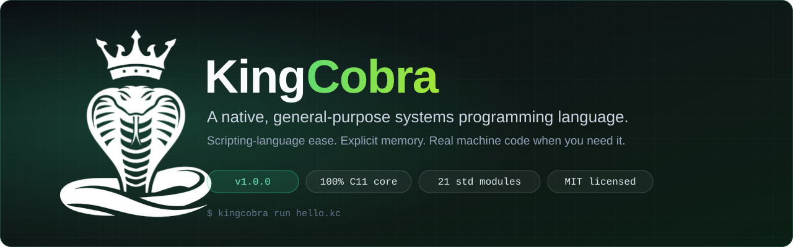

<div align="center">



<br>

[](https://github.com/DivyanshuSinha136/kingcobra/actions/workflows/ci.yml)
[](https://github.com/DivyanshuSinha136/kingcobra/releases)
[](LICENSE)


**[Quick start](#-quick-start)** ·
**[Language tour](#-language-tour)** ·
**[Tutorial](index.html#tutorial)** ·
**[Toolchain](#-the-toolchain)** ·
**[Standard library](#-standard-library)** ·
**[Documentation](#-documentation)** ·
**[Contributing](#-contributing)**

</div>

---

## ✨ What is KingCobra?

KingCobra is a **native, general-purpose systems programming language** that feels like a scripting language and
behaves like a systems language. It has a small, readable syntax and a REPL, but it also gives you explicit memory,
C-style pointers, a real FFI, raw machine code, and a bare-metal compiler target.

The whole project — language, runtime, JIT, and every standard-library module — is plain **C11** with **no third-party
build-time dependencies**. Build it with `make`.

```kingcobra
enum Shape { Circle, Square = 10, Triangle }

struct Point { x: int, y: int }
impl Point { fn len2(self) -> int { return self.x * self.x + self.y * self.y; } }

fn parse_age(text: string) -> int {
    let n = int(text);
    if (n < 0) { throw error("age cannot be negative"); }
    return n;
}

fn main() {
    let nums = [5, 3, 8, 1, 9];
    let [first, ...rest] = nums;
    print(f"first={first} squares>10={nums.map(fn(x) -> int { return x * x; }).filter(fn(x) -> bool { return x > 10; })}");
    print(Point { x: 3, y: 4 }.len2(), nums[1..3], 8 in nums ? "has 8" : "no 8");

    for (text in ["30", "-4"]) {
        try { print("age", parse_age(text)); } catch (e) { print("rejected:", e.message); }
    }
}
```

> This is [`examples/language_tour.kc`](examples/language_tour.kc), which the test suite runs on every build.

## 🎯 Why KingCobra

| | |
|---|---|
| 🐍 **Easy like a script** | `let`/`var`, f-strings, slicing, destructuring, `match`, `try`/`catch`, a REPL, and `help()` with `///` doc comments. |
| ⚙️ **Native underneath** | Exact 64-bit integers, a closure **JIT to x86-64 machine code**, a real `extern` FFI, and `rhex` + `unsafe` for raw machine code. |
| 🧠 **Explicit memory, no GC** | `free` works on every heap value; use-after-free and double free are *errors*; `defer` runs even while an error unwinds; `--leaks` finds what you forgot. |
| 🛡️ **Checked pointers** | C-style pointers and buffers with bounds- and lifetime-checking. |
| 🔋 **Batteries included** | 21 native standard-library modules — networking, HTTP/TLS, JSON, regex, neural networks, a game engine, TTS, a software MMU, and more. |
| 🧰 **Real tooling** | Built-in `test`, `check`, a static type checker, errors with source excerpts and *“did you mean”*, a terminal IDE and debugger. |
| 🔩 **Down to bare metal** | `kcc` compiles KingCobra to standalone executables — and to a freestanding kernel. **KCOS**, an OS written in KingCobra, boots in QEMU. |
| 🌍 **Portable** | Linux and Windows (macOS builds with `make`). x86-64, ARM64, ARMhf and RISC-V. |

## 🚀 Quick start

**Requirements:** a C11 compiler and `make`.

```bash
git clone https://github.com/DivyanshuSinha136/kingcobra.git
cd kingcobra

make                              # builds ./kingcobra
./kingcobra run examples/hello.kc
./kingcobra repl                  # interactive REPL
make test                         # runs every example end-to-end
```

### Install

The release page has a build for each kind of device, and the installers pick the right one for yours and verify its
SHA-256 checksum. If there is no prebuilt package for your machine, they compile KingCobra **on your machine** from the
source release (needs a C compiler and `make`).

<details open>
<summary><b>Linux / macOS</b></summary>

```bash
curl -fsSL https://github.com/DivyanshuSinha136/kingcobra/releases/latest/download/install.sh | sh
```

| Your machine | You get |
|---|---|
| Debian / Ubuntu (amd64, arm64, armhf, riscv64) | `.deb`, installed with apt |
| Fedora / RHEL / Rocky / Alma / openSUSE (amd64, arm64) | `.rpm`, installed with dnf / zypper |
| Alpine and other musl Linux (amd64, arm64) | tarball into `~/.local` (or `/usr/local` as root) |
| macOS, Apple Silicon or Intel | tarball into `~/.local` (or `/usr/local` as root) |
| Raspberry Pi 2-5, Orange Pi, BeagleBone, VisionFive, Milk-V and other ARM / RISC-V microcomputers | the Linux row for their CPU (the board model is shown) |
| Raspberry Pi Zero / 1 (ARMv6), Android (Termux), other CPUs, BSDs | compiled on the device from the source release |

Options: `KC_VERSION=1.0.0`, `KC_METHOD=deb|rpm|tar|src` (`src` always compiles locally), `KC_PREFIX=...`,
`KC_DRY_RUN=1`, `KC_INSTALL_DEPS=1` (fetch the compiler and headers first), `KC_JOBS`, `KC_TMPDIR`; remove it again with `sh install.sh --uninstall`. Homebrew users can also use the formula attached
to each release (see [docs/PACKAGING.md](docs/PACKAGING.md)).

Bare-metal microcontrollers (Arduino, ESP32, RP2040, STM32) have no operating system or C library, so KingCobra cannot
run on them; use a microcomputer that runs Linux.

From a source checkout:

```bash
sudo make install                 # binary, `kc` alias, man pages, *.kc file type and icon (PREFIX=/usr, DESTDIR supported)
make install-mime-user            # no root: file type + icon for the current user only
make uninstall                    # remove everything `install` added
make deb                          # Debian/Ubuntu package for this machine  (make rpm for Fedora & co.)
```

</details>

<details>
<summary><b>Windows</b></summary>

PowerShell, no administrator rights needed:

```powershell
irm https://github.com/DivyanshuSinha136/kingcobra/releases/latest/download/install.ps1 | iex
```

or with a package manager:

```powershell
choco install kingcobra                  # Chocolatey (PowerShell as Administrator)
scoop install https://github.com/DivyanshuSinha136/kingcobra/releases/latest/download/kingcobra.json    # Scoop
```

Then open a new terminal and check it:

```powershell
kingcobra version
kingcobra repl
```

The Windows build is x64, statically linked, JIT included (on Windows on ARM it runs through the built-in emulation).
Update with `choco upgrade kingcobra` / `scoop update kingcobra`, remove with `choco uninstall kingcobra` /
`scoop uninstall kingcobra`.

To open `.kc` files with the KingCobra icon, run `packaging\windows\associate.ps1` from the release zip. To build it
yourself, use MSYS2 / MinGW-w64 (`make` + `gcc` on `PATH`), then `make install-windows`. Native MSVC (`cl`/`nmake`) is not
supported by the Makefile. See [docs/PLATFORMS.md](docs/PLATFORMS.md) and [docs/PACKAGING.md](docs/PACKAGING.md).

</details>

<details>
<summary><b>Faster build (PGO) and cross-compiling</b></summary>

```bash
make pgo                          # profile-guided build: 10–25% faster than plain `make`
make arm64                        # also: make armhf, make riscv64 (need the matching gcc cross toolchain)
```

</details>

### The REPL

```text
$ kingcobra repl
>>> let x = 10
>>> x * 3
30
>>> fn fact(n: int) -> int {
...     if (n < 2) { return 1; }
...     return n * fact(n - 1);
... }
>>> fact(10)
3628800
>>> _ + 1
3628801
```

Definitions persist, unclosed brackets continue on the next line, errors never end the session, and `_` is the last
result. With GNU readline you also get line editing, history and Tab completion. → [docs/REPL.md](docs/REPL.md)

## 📖 Language tour

| Feature | Example |
|---|---|
| Variables & types | `let x: int = 10;` · `var name = "cobra";` · `int` (64-bit) `float` `string` `bool` `null` |
| Functions & closures | `fn adder(x: int) -> fn { fn inner(y: int) -> int { return x + y; } return inner; }` |
| Control flow | `if` · `while` · `for (i in 0..10)` · `for (x in arr)` · labeled loops · `switch` · `goto` · `do` |
| `match` | `match (n) { 0 => "zero", _ => "many" }` |
| Structs & `impl` | `struct Point { x: int, y: int }` · `Point { x: 1, y: 2 }` |
| Enums | `enum Shape { Circle, Square = 10, Triangle }` |
| Errors | `try { … } catch (e) { … }` · `throw error("…")` · `defer` |
| Operators | `?:` · `??` · `in` · slicing `a[1..3]` · destructuring `let [a, ...rest] = xs;` |
| `comptime { }` | Purity-enforced, run-once computation; side-effecting natives are refused inside |
| `unsafe { }` | Required before anything genuinely memory-unsafe (e.g. `rhex` raw code) |
| FFI | `extern fn sqrt(x: float) -> float from "libm.so.6";` |
| Native import | `import "lib.o" as mu;` then `mu.symbol(args)` — no `extern` declaration needed |
| Modules | `import std.json;` · `import "file.kc";` |
| C and B | `static`, `union`, a C preprocessor, the C standard library, B's `auto` / `extrn` / vectors |

KingCobra runs a **static type checker** before your program does (`let`/`var` annotations, call signatures, return
types, struct field types). It is deliberately permissive rather than exhaustive; skip it with `--no-typecheck`.

📚 Full specification: [LANGUAGE.md](docs/LANGUAGE.md) · [GRAMMAR.md](docs/GRAMMAR.md) · [C_AND_B.md](docs/C_AND_B.md) ·
[POINTERS.md](docs/POINTERS.md) · [MEMORY.md](docs/MEMORY.md)

## 🧰 The toolchain

```text
kingcobra run <file.kc>      run a program                  kingcobra -e 'print(6 * 7)'    run a snippet
kingcobra repl               interactive session            kingcobra -p '6 * 7'       print one expression
kingcobra check <path>…      parse + type-check (--format=json for tools)
kingcobra test [path]…       run every test_* function      kingcobra new <name>           scaffold a project
kingcobra --leaks x.kc       report memory you forgot to free
kingcobra info               version, platform, JIT status, build features
```

A mistyped command is caught with a suggestion:

```text
$ kingcobra chek a.kc
kingcobra: unknown command 'chek' — did you mean 'check'?
```

Shell completions are available for bash, zsh and fish (`kingcobra completions <shell>`). → [docs/CLI.md](docs/CLI.md)

| Tool | What it is | Docs |
|---|---|---|
| **`kingcobra`** | Interpreter with a tiered closure JIT, static type checker, REPL, test runner | [CLI](docs/CLI.md) |
| **`kcide`** | Terminal IDE in dependency-free C11: syntax highlighting, multi-tab editor, `std.*` completion, live diagnostics, F5 run, integrated terminal/REPL, **debugger** (breakpoints, stepping, call stack, watches) | [IDE](docs/IDE.md) · [Debugger](docs/DEBUGGER.md) |
| **`kcc`** | KingCobra-to-native compiler *written in KingCobra*: emits `.exe`, ELF and Mach-O executables, plus `.o` / `.so` / `.dll` / `.dylib` | [KCC](docs/KCC.md) |
| **`kasm`** | NASM-style x86 assembler *written in KingCobra*: 16/32/64-bit, macros, ELF / bin / HEX output, SSE–AVX/FMA/BMI | [KASM](docs/KASM.md) |
| **KCOS** | An x86-64 operating system *written in KingCobra*, compiled by `kcc --target kcos`; boots in QEMU | [KCOS](docs/KCOS.md) |

```bash
make ide && ./ide/kcide examples/                   # terminal IDE
kcc/kcc app.kc -o app.exe                           # compile to a native executable
kasm/kasm prog.kasm -f elf -o prog                  # assemble to a Linux ELF
make -C kcos run                                    # boot KCOS in QEMU
```

## 📦 Standard library

21 native modules, no external dependencies. Load one with `import std.<name>;`.

<table>
<tr><th>Area</th><th>Modules</th></tr>

<tr><td><b>System &amp; hardware</b></td><td>

[`std.system`](docs/STD_SYSTEM.md) — OS/CPU/memory info, environment, filesystem, clocks, processes (spawn, capture, timeouts) ·
[`std.memory`](docs/MEMORY.md) — explicit bounds-checked buffers ·
[`std.rhex`](docs/STD_RHEX.md) — raw machine code, `cpuid`/`rdtsc`/`rdrand`, MSR/port access ·
[`std.mmio`](docs/STD_MMIO.md) — memory-mapped I/O, port I/O, PCI config space ·
[`std.acpi`](docs/STD_ACPI.md) — ACPI table discovery and parsing ·
[`std.mmu`](docs/STD_MMU.md) — software MMU (x86 / ARM64 / RISC-V page tables, TLB, COW fork, swap) plus real host virtual memory

</td></tr>

<tr><td><b>Networking</b></td><td>

[`std.network`](docs/STD_NETWORK.md) — TCP/UDP, raw sockets, byte-level protocol builder ·
[`std.http`](docs/STD_HTTP.md) — HTTP/1.1 client with verified HTTPS, redirects, gzip/deflate, cookies, plus a small server

</td></tr>

<tr><td><b>Data formats</b></td><td>

[`std.json`](docs/STD_JSON.md) — strict RFC 8259, JSONPath, RFC 6901/6902/7396, schema validation, JSON Lines ·
[`std.csv`](docs/STD_CSV.md) — RFC 4180 CSV/TSV, streaming, type inference, sort/filter/stats ·
[`std.fbin`](docs/STD_FBIN.md) — binary files and byte streams, struct pack/unpack, hexdump, base64, crc32/sha256 ·
[`std.io`](docs/LANGUAGE.md) — file and console I/O

</td></tr>

<tr><td><b>Text &amp; language</b></td><td>

[`std.regx`](docs/STD_REGX.md) — backtracking regex with named groups, lookahead, backrefs ·
[`std.nlp`](docs/STD_NLP.md) — tokenizer, stemmer, TF-IDF, BM25, naive Bayes, spell correction, summarizer

</td></tr>

<tr><td><b>AI &amp; math</b></td><td>

[`std.nn`](docs/STD_NN.md) — tensors, dense/conv/RNN/LSTM/GRU/attention/transformer layers, Adam/AdamW/RMSprop, gradient checking, save/load ·
[`std.vector`](docs/STD_VECTOR.md) — N-D vectors, quaternions, mat3/mat4, ray tests

</td></tr>

<tr><td><b>Graphics, games &amp; UI</b></td><td>

[`std.game`](docs/STD_GAME.md) — 2D + 3D engine, chunk-streamed worlds, OBJ/glTF/FBX loaders ·
[`std.gui`](docs/STD_GUI.md) — layouts, tabs, dialogs, canvas; X11 / Win32 / headless ·
[`std.ascii_screen`](docs/STD_ASCII_SCREEN.md) — TUI engine and image/GIF/video → ASCII

</td></tr>

<tr><td><b>Audio &amp; speech</b></td><td>

[`std.music_note`](docs/STD_MUSIC_NOTE.md) — music theory, multi-track notation language, 20+ instruments, full DSP toolbox, WAV/MIDI, phonk/funk generation ·
[`std.tts`](docs/STD_TTS.md) — text-to-speech with text normalisation, pronunciation engine (ARPAbet &amp; IPA) and expressive style tags

</td></tr>
</table>

Run `kingcobra modules` to list them, and see [`examples/`](examples) for a runnable program per module — `make test`
proves they all work. Seven real-world programs (log analyzer, REST API, physics lab, binary protocol, …) live in
[`examples/showcase`](examples/showcase/README.md).

## 🧠 Memory model

There is deliberately **no garbage collector**.

- `free` works on every heap value. **Use-after-free and double free are runtime errors**, not silent corruption.
- `defer` runs even while an error unwinds.
- Pointers and buffers are bounds- and lifetime-checked.
- `kingcobra --leaks prog.kc` reports every block that was allocated and never freed, with where it was allocated.

→ [docs/MEMORY.md](docs/MEMORY.md) · [docs/POINTERS.md](docs/POINTERS.md)

## ⚡ Execution model

KingCobra is a **tree-walking interpreter with a tiered closure JIT**.

1. Every program runs correctly in the interpreter from the first call.
2. A closure called `KC_JIT_THRESHOLD` (50) times that fits an int-only shape — up to 4 parameters, locals, arithmetic,
   comparisons, `&&`/`||`/`!`, `if`/`else`, `while`, and **self-recursive calls** — is compiled once to **x86-64
   machine code** and called natively from then on. A hot `fib` measures ~108× faster than the same function forced to
   stay interpreted.
3. **The JIT is optional.** A one-time self-test turns it off if the platform can't or won't run generated code
   (or with `--no-jit` / `KC_JIT=0`); results are identical either way. `kingcobra info` shows which tier you're on.

→ [docs/PERFORMANCE.md](docs/PERFORMANCE.md)

## 🌍 Platforms

| Platform | Status |
|---|---|
| Linux x86-64 | Interpreter + JIT; CI-tested (blocking) |
| Linux ARM64 | Interpreter; CI-tested natively (blocking) |
| Linux ARMhf · RISC-V 64 | Interpreter; built and tested under QEMU in CI (reported, non-blocking) |
| macOS | Builds directly with `make`; not covered by CI. On Apple Silicon, `std.rhex` code execution is refused (`MAP_JIT`) |
| Windows (MSYS2 / MinGW-w64) | Supported; `choco install kingcobra` (x64) |

Only x86-64 has the JIT; other CPUs run the interpreter with identical results. → [docs/PLATFORMS.md](docs/PLATFORMS.md)

## 🗂️ Project layout

```text
kingcobra/
├── compiler/        the language itself (C11): lexer, parser, type checker, interpreter, closure JIT, FFI
├── std/             21 native standard-library modules
├── kcc/             KingCobra → native compiler (written in KingCobra)
├── kasm/            x86 assembler (written in KingCobra)
├── kcos/            operating system (written in KingCobra)
├── ide/             kcide — terminal IDE and debugger
├── examples/        runnable .kc programs, all verified by `make test`
├── tests/           language and module test suites
├── docs/            language spec, CLI, per-module references, roadmap
├── packaging/       deb, rpm, Homebrew, Scoop, Chocolatey, installers and CI release tooling
├── assets/          logo and file-type icons
└── Makefile
```

## 📚 Documentation

| Start here | Reference | Project |
|---|---|---|
| [Language spec](docs/LANGUAGE.md) | [CLI](docs/CLI.md) | [Roadmap](docs/ROADMAP.md) |
| [Grammar](docs/GRAMMAR.md) | [REPL](docs/REPL.md) | [Changelog](docs/CHANGELOG.md) |
| [C and B features](docs/C_AND_B.md) | [Memory](docs/MEMORY.md) · [Pointers](docs/POINTERS.md) | [Stability policy](docs/STABILITY.md) |
| [Examples](examples) | [Performance](docs/PERFORMANCE.md) | [Packaging](docs/PACKAGING.md) |

## 🧭 Status & honesty

KingCobra is **v1.0.0** — a real, working language. The project documents its limits openly rather than
hiding them: the JIT covers a specific int-only shape on purpose, the static type checker is permissive, Win32 GUI is
written but less tested than X11, and KCOS has been booted and checked in QEMU but not tried on real hardware.
[docs/STABILITY.md](docs/STABILITY.md) says what you can rely on; [docs/ROADMAP.md](docs/ROADMAP.md) says what's next.

## 🤝 Contributing

Bug reports, ideas and pull requests are welcome.

1. Open an [issue](https://github.com/DivyanshuSinha136/kingcobra/issues) describing the problem or proposal.
2. Fork, branch, and make your change.
3. Run `make test` (and `./kingcobra test`) before opening a pull request.

## 📄 License

Released under the [MIT License](LICENSE).

---

<div align="center">

**KingCobra** is created and maintained by **[Divyanshu Sinha](https://github.com/DivyanshuSinha136)**
· [divyanshu.sinha631@gmail.com](mailto:divyanshu.sinha631@gmail.com)

<sub>If KingCobra is useful to you, consider giving it a ⭐</sub>

</div>
